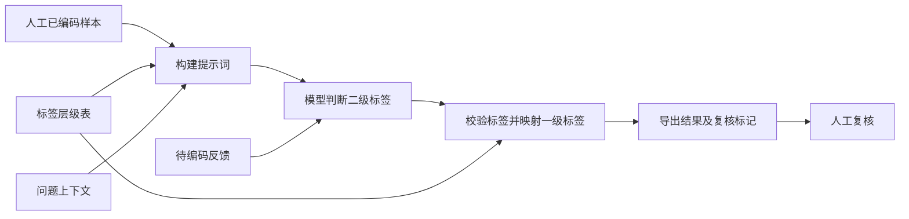

# AI 用户反馈自动编码工具

将问卷开放题、访谈原话或用户反馈，转换为可汇总分析的多级标签。工具读取人工已编码样本和标签体系，调用大语言模型完成初步分类，自动校验标签并导出结果，供研究人员复核。

这个项目展示了如何把用户研究中的重复打标步骤整理为可运行的自动化流程。公开版基于原有 `user_text_encoder_v3.py` 整理，保留样本提示、多标签编码、人工层级映射和问题上下文等核心逻辑，并增加配置修复、输入检查和离线演示。

**仓库内全部示例均为虚构数据。离线演示使用预设模型响应，不调用真实模型，不代表预测准确率。**

## 快速了解

| 环节 | 自动完成的工作 | 人工负责的工作 |
| --- | --- | --- |
| 准备 | 读取 Excel 或 CSV | 定义标签，提供高质量的已编码样本 |
| 编码 | 将标签、样本、问题背景传入模型 | 选择模型和合适的样本数量 |
| 校验 | 检查标签是否有效，按人工层级表映射一级标签 | 处理歧义、空标签和异常结果 |
| 交付 | 导出标签、模型自报置信度和复核标记 | 复核后汇总、分析并形成研究结论 |



“学习样本”指将样本放进提示词作为示范，即 few-shot prompting，不涉及训练或微调模型。批处理采用逐条请求，`--batch-size` 控制暂停频率，不是并发数量。

## 先看一个例子

以下是离线演示中的**预设响应**经过校验和层级映射后得到的结果：

| 虚构用户反馈 | 一级标签 | 二级标签 | 模型自报置信度 | 需人工复核 |
| --- | --- | --- | --- | --- |
| 页面加载很慢，客服也迟迟不回复。 | 产品体验、服务体验 | 页面加载慢、客服响应慢 | high | 否 |
| 工作人员很耐心，但设置入口不太好找。 | 产品体验、服务体验 | 服务态度好、功能难找 | medium | 是 |
| 一般吧。 | 空 | 空 | low | 是 |

`high` 也可能出错，“无需复核”标记只代表未触发规则，不表示结果已通过人工确认。实际使用时，建议抽检高置信度结果，并优先检查其他结果。

## 运行离线演示

需要 Python 3.10 或更高版本。在下载后的项目目录打开终端：

```bash
python -m venv .venv
# macOS / Linux
source .venv/bin/activate
# Windows PowerShell 请改用：.venv\Scripts\Activate.ps1
python -m pip install -r requirements.txt
python demo.py
```

结果保存至 `outputs/demo_result.csv`，可用 Excel 打开，也可直接查看仓库中的 [示例结果](examples/demo_result.csv)。演示覆盖读取文件、多标签校验、一级标签映射、空文本处理、复核标记和结果导出。重复运行时请指定新文件名，例如 `python demo.py --output outputs/demo_result_2.csv`。

## 使用真实模型

先在终端设置你自己的 API 配置。`.env.example` 仅作配置参考，程序不会自动读取 `.env` 文件。

macOS / Linux：

```bash
export OPENAI_API_KEY="你的密钥"
export OPENAI_BASE_URL="https://api.openai.com/v1"
```

Windows PowerShell：

```powershell
$env:OPENAI_API_KEY="你的密钥"
$env:OPENAI_BASE_URL="https://api.openai.com/v1"
```

将 `你的模型名称` 替换为所配置服务支持的模型，再运行：

```bash
python user_text_encoder_v3.py --model "你的模型名称" --train examples/train.csv --predict examples/predict.csv --hierarchy examples/hierarchy.csv --question "你对这款示例产品有什么意见或建议？" --output outputs/predictions.xlsx
```

接口采用 OpenAI SDK 的 Chat Completions 调用形式。其他服务须兼容该接口，且支持 `temperature` 和 `max_tokens` 参数；并非所有模型均可直接使用。真实运行会将入选的人工样本、标签体系、问题背景及待编码原话发送给所配置的 API 服务，并产生该服务的调用费用。首次使用请先用仓库里的虚构数据验证。

## 输入与输出

| 文件 | 必需列 | 用途 |
| --- | --- | --- |
| 已编码样本 | `用户原话`、`一级编码`、`二级编码` | 提供候选标签和示例 |
| 待编码反馈 | `用户原话` | 保存原有列并添加预测列 |
| 人工层级表，可选 | `一级编码`、`二级编码` | 每行一个对应关系；一个二级标签只能对应一个一级标签 |

支持 `.xlsx` 和 `.csv`。Excel 默认读取第一个工作表。多标签可用中文顿号、逗号、分号、竖线或换行分隔，因此标签名称本身应避免这些字符。提供层级表时，以表中的标签为准；未提供时，从样本中收集标签间的共现关系，歧义可能更大。

输出新增 `预测_一级编码`、`预测_二级编码`、`置信度`、`需人工复核`。空文本直接返回空标签；响应无效或调用失败会重试，耗尽重试后标记为“编码失败”。输出路径不能覆盖输入文件或既有结果。导出时，对可能被表格软件当成公式的文本加单引号。

## 常用参数

| 参数 | 默认值 | 说明 |
| --- | --- | --- |
| `--model` | 必填 | 服务支持的模型名称 |
| `--hierarchy` | 不指定 | 人工层级映射文件 |
| `--question` | 不指定 | 用户回答对应的问题 |
| `--examples-per-label` | 3 | 每个标签最多引用的样本数 |
| `--max-examples` | 30 | 单次提示词中的示例条目总上限 |
| `--batch-size` | 5 | 每处理 N 条暂停 0.5 秒 |
| `--max-retries` | 3 | 每条主要编码请求最多尝试次数 |
| `--temperature` | 0.0 | 模型输出随机性参数 |
| `--text-column` | 用户原话 | 文本列名称 |
| `--label-columns` | 一级编码 二级编码 | 标签列名称 |

样本按标签顺序选入并受总量限制，总上限过小时，靠后的标签可能没有示例。无层级表模式下，同一原话可能分别用于不同级别标签，并占用多个示例名额。每条示例截取前 80 字。增加示例会增加上下文长度和费用，效果需要用独立标注的验证集衡量。

## 验证与边界

```bash
python -m unittest discover -s tests -v
```

测试使用本地模拟响应，不需要密钥。覆盖标签映射、非法响应、重试、空文本、样本总上限、结果导出和输入文件保护。公开版未在真实业务数据上重新测量准确率或调用成本；模拟测试只能证明流程行为，不证明模型表现。

模型自报置信度没有经过概率校准。推荐人工检查所有低置信度、空标签和失败结果，同时抽检高置信度结果。工具当前没有断点续跑、并发任务、审核界面或长文本自动分段，适合先做小规模验证。

## 项目结构

```text
user_text_encoder_v3.py  编码主流程与命令行入口
demo.py                 不需要密钥的模拟演示
examples/               虚构样本、层级表及模拟结果
tests/                  无网络的功能测试
docs/release-notes.md    原版逻辑与公开版改动说明
```

真实调研数据、原业务标签表、内部报告和 API 密钥均不包含在仓库中。使用自己的数据时，可存放到被 Git 忽略的 `private_data/` 目录。公开前仍应检查待提交文件，忽略规则不会移除已经提交过的内容。
